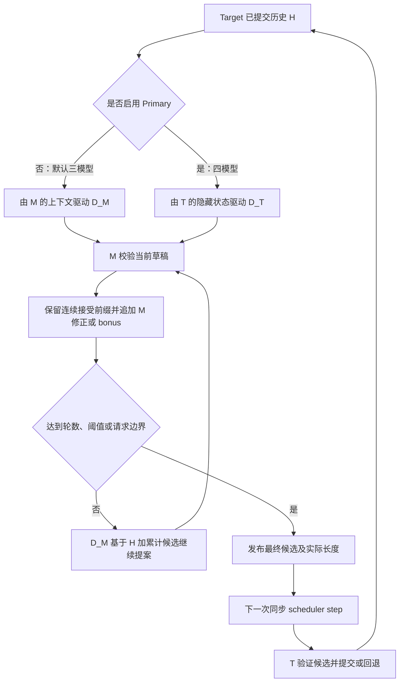

# 层次化投机解码项目说明与 Codex 实施指南

本文保存当前已接通的三模型、四模型层次化 DFlash 方案，作为后续在 vLLM 或 vLLM-Ascend 上复现、迁移和继续开发的交接文档。后续会话可以直接让 Codex 先读本文件，再按阶段修改目标仓库。

整理日期：2026-11-11。文中的“当前实现”指本地 `vllm-ascend` 工作树，基线为 `dfc61cbcfd07a3e8cf1bb4825fcd83a760ce5bcc`。本文新增时该工作树无已有未提交改动。

## 1. 目标、范围与当前状态

目标是用较小的中间 verifier 和配套 DFlash 多轮生成较长候选，再交给 Target 一次验证，以减少昂贵的 Target 调用。是否产生端到端收益，取决于中间计算、接受率、KV 复用、图 padding 和调度成本，必须实测。

本项目保留两条路径：

| 路径 | 实际加载的模型 | 第一轮草稿来源 | 后续草稿来源 |
| --- | --- | --- | --- |
| 默认三模型 | Target、Intermediate Verifier、Intermediate DFlash | Intermediate DFlash | 同一个 Intermediate DFlash |
| 可选四模型 | 上述三者，再加 Target 配套 Primary DFlash | Primary DFlash | Intermediate DFlash |

本文中的 Target 8B、中间 4B 是当前方案示例；模型大小并非算法约束，实际权重必须满足 tokenizer、架构和 DFlash 配对条件。

| 能力 | 当前状态与证据边界 |
| --- | --- |
| 三模型、四模型及多轮候选发布 | 当前源码已接通，有 CPU 替身回归测试 |
| 中间与最终 `topk`、`all`、`prob_ratio` | 已接通；均为近似策略，不保证 Target 随机采样分布等价 |
| 独立中间 KV、缓存复用、请求生命周期 | 已接通；需要 NPU 验证真实分配和数据依赖 |
| 长候选 cached-prefill、FULL 图路径 | 已有代码和 NPU 测试用例；不等于本次已运行通过 |
| 历史 CPU 回归 | 迁移记录报告 455 项测试、231 项子测试通过；本文整理未重跑这些测试 |
| 实际 Target/4B/DFlash 权重配对、NPU 精度与性能 | **[未核实]**，没有本次真机验证或性能报告 |
| 上游 vLLM GPU 迁移版 | 本文给出实施路线，当前工作区未提供已完成的 GPU 端实现 |

按本次范围选择，exact sampling、λ 混合提案、自适应反馈以及 `proposal_sampling_results` 的试验路线均不纳入实施范围。旧 exact 文件不能作为已完成能力迁入生产路径。

## 2. 模型角色与数据流

符号约定：`T` 为 Target，`M` 为中间 verifier，`D_M` 为与 M 配对的 DFlash，`D_T` 为与 T 配对的可选 Primary DFlash；`H` 是 Target 已正式提交的历史，`C` 是本周期尚未提交的累计候选。



三模型路径首次提案前，由 M 补齐已提交上下文，生成辅助隐藏层并填充 D_M 的 context KV。D_M 使用 M 对应的辅助隐藏层、embedding/lm_head 和 KV，不消费 T 的隐藏层或 KV。首轮与后续轮共用同一实例，不额外加载 D_T。

四模型路径先复用原 Target+DFlash 的提案，M 第一轮校验 Primary 草稿；只有后续轮才由 D_M 继续提案。D_T 和 D_M 必须分别匹配各自的条件模型。

M 产生的 token 始终只是候选。正式请求历史、输出提交和 Target KV 回退由 T 的原有流程负责。

## 3. 一次 Target 周期的算法契约

以下伪代码描述单个请求；实际代码按驻留请求组执行，并在组内使用 microbatch。

```text
输入：已提交历史 H，轮数 n，初始宽度 p，后续宽度 d，可选阈值 m
      请求剩余候选预算 limit
C = []
首轮草稿 = D_T(H)（四模型）或 D_M(H)（三模型）

对 round = 1 ... n：
    M 对 H + C + 当前草稿进行 teacher-forcing 验证
    a = 从草稿开头起连续通过策略的 token 数
    z = M 在首次拒绝位置的 greedy 修正；全接受则为 greedy bonus
    将 草稿[:a] + [z] 追加到 C，遵守 EOS、请求和上下文边界
    若达到 n 轮、遇到 EOS、耗尽 limit，或 len(C) > m：停止
    当前草稿 = D_M(H + C)，并遵守剩余预算

把 C 及其真实长度发布给 scheduler
下一步 T 验证 C，保留连续接受前缀
首次拒绝时追加 T sampler 的修正 token
全接受时根据三模型/四模型约定处理 Target bonus
沿用原 Target 提交、进度计数和 KV 回退
```

每轮首次拒绝即结束该轮，后续轮基于修正后的实际候选重新生成。最后一轮结束后不会再追加未经 M 校验的新草稿。

### 3.1 接受策略

中间策略由 `intermediate.verification` 配置，最终策略由 `final_verification` 配置，二者独立。

| 策略 | 接受条件 | 必须保留的细节 |
| --- | --- | --- |
| `topk` | 候选 token 位于当前预测行的有限 logit Top-k 中 | 只保留连续前缀；`top_k` 为正整数；不是请求采样参数中的同名字段 |
| `all` | 接受有效范围内的候选 | 无效 token/placeholder 仍须拒绝；适合链路与容量验证，不能证明输出质量 |
| `prob_ratio` | `P(candidate) / max(P) > threshold` | 使用严格大于；不使用 DFlash 概率，不是标准概率拒绝采样 |

`prob_ratio` 用 `logit(candidate) - max(logit) > log(threshold)` 等价实现。阈值范围为 `[0,1]`：0 接受有限有效候选，1 拒绝全部候选；被屏蔽、非有限和越界 token 不接受。Top-k 的并列排序应沿用实际后端，不能自行假定并列 token 的顺序。

中间 DFlash、中间修正及中间 bonus 使用 greedy。最终 Target 修正/bonus 由原 sampler 生成，使用请求采样参数；最终接受策略读取 sampler 处理后的 logits，温度、惩罚和过滤会影响接受结果。因此需要分别验证中间策略和最终策略。

经过 M 替换、扩展后的候选不再对应原 Primary 的 `draft_logits`。当前最终验证只调用 Target sampler，再对其处理后的 logits 应用近似策略；不能把旧 Primary 概率直接交给普通拒绝采样器并宣称语义相同。

最终 Top-1 在 greedy、有限 logits、确定性且并列处理一致等条件下可作逐 token 对照；不得将此结论推广到随机采样或其他近似策略。

### 3.2 Target bonus 的模式差异

| 情况 | 默认三模型 | 可选四模型 |
| --- | --- | --- |
| 候选全部接受 | 只提交候选，省略 Target bonus | 提交候选并保留 Target bonus |
| 首次拒绝 | 接受前缀加 Target 修正 | 接受前缀加 Target 修正 |
| 无候选 | 正常生成一个 Target token | 正常生成一个 Target token |

三模型省略 bonus 是当前已实现行为：中间 verifier 发布的末尾修正/bonus 可作为下一周期 anchor，有效 context KV 命中时省去补算。仍保留 Target 验证输入中的 bonus 预测行和原 sampler 的批量处理，只调整最终提交数。

迁移时必须保留 `computed_length = total_length - 1` 对下一轮 anchor 的约定。`accepted_lengths` 不含修正/bonus；不要直接用输出 token 数替代接受数。仅配置最终策略或关闭中间轮次时，保留普通 Target bonus 行为。

## 4. 轮数、阈值与容量

必须区分：单次 DFlash 宽度、最终候选存储容量、每个请求实际候选数。它们不是同一个参数。

令 `n >= 1`，`p` 为初始草稿宽度，`d` 为后续 D_M 宽度。三模型中 `p = d`；四模型中 `p` 独立配置。

```text
无阈值的候选容量：K0 = (p + 1) + (n - 1) * (d + 1)
有阈值且 n > 1： K  = min(K0, max(p + 1, m + d + 1))
仅一轮：         K  = p + 1
```

`+1` 为该轮的 M 修正或 bonus。`m = intermediate.max_generated_tokens` 是完成一轮后的停止阈值：累计数严格超过 m 才停，等于 m 仍继续，超过后保留该轮完整结果。它不是硬截断长度；请求剩余输出、EOS、上下文容量和 runner 预算仍可裁剪。

示例：`d=4,n=4,m=12`，全接受时累计 5、10、15，第三轮停止并发布 15 个候选；容量推导为 17，以覆盖其他接受模式产生的越界位置。`m=0` 表示完成首轮即停，省略 m 表示只按轮数及请求边界停止。

每次 DFlash 宽度在本实现中不超过 15，但多轮累计 K 可以超过 15。三模型 `d=15,n=3` 的 K 为 48，不是 45；这是近似策略每轮包含 M 修正/bonus 的容量定义，不应套用其他实验的计数规则。

容量必须在 scheduler、Target KV、采样缓冲区和图尺寸默认值初始化之前推导并写回 `speculative_config.num_speculative_tokens`。实际长度另行发布。`max_num_batched_tokens >= K + 1` 是单个完整验证块的必要条件，多请求批量还受总 token 预算约束。

## 5. 状态、缓存与数据所有权

| 状态 | 所有者 | 生命周期与失效条件 |
| --- | --- | --- |
| 正式历史、Target KV、已计算进度 | 原 Target runner/scheduler | 仅按最终 Target 提交更新 |
| 中间 verifier 与 D_M 私有 KV | `IntermediateBackend` | 按请求 ID 和实际 token 前缀复用；分歧处覆盖、结束释放、容量不足 LRU 淘汰 |
| 本周期候选与有效长度 | pipeline/adapter | 发布至下次 Target 验证；未调度请求的待验证候选须保留 |
| 主机历史快照 | adapter | 用有界历史尾部增量更新；冷请求回传完整历史；请求 ID 重用前失效 |
| 图输入、页表、RoPE 与参数上下文 | 各模型独立 manager | 地址稳定；不能用另一个模型的参数上下文覆盖 |
| 临时图输出和候选视图 | 当前调用/验收包 | 重放可能覆盖；后续消费者需使用有明确所有权的独立存储 |

以下约束是实现验收项：

1. M 与 T 的完整词表/token ID 映射必须一致，不能只检查词表大小。D_M 必须匹配 M，D_T 必须匹配 T。
2. M 和 D_M 的 KV 分组及地址独立于 T；中间接受不提交正式历史。两套中间 KV 更新成功后才发布有效前缀。
3. Target 拒绝后，下一周期根据实际 token 前缀恢复中间缓存；不能仅按长度命中。请求结束、取消、同 ID 新请求均须清理旧状态。
4. batch row 与持久 request-state index 分开。混合长短请求重排时，所有逐请求数组、请求 ID 和映射必须同步重排。
5. 未完成 prefill 不进入中间流水线；`-1` 等 placeholder 不得参与词表 gather 或被接受。
6. 每个驻留请求组内部完成多轮后再换组，避免按全局 round 轮转引发 KV 反复淘汰。计算 microbatch 与 KV 驻留槽位可不同。
7. 异步 H2D 的 pinned 源在传输完成前不得覆盖。保存图输出供后续使用时防止下次 replay 改写；不能为减少 copy 数盲目删除必要复制。

`cache_max_num_seqs` 可大于计算用 `max_num_seqs`，但每个槽位仍按 `max_model_len` 预留私有 KV。扩槽不扩大图计算 batch，也不是低成本开关；内存预算需包含 T、可选 D_T、M、D_M、私有 KV、图池和临时缓冲区。

## 6. 长候选与 NPU 图执行

Target 验证 query 由一个已提交的 context/anchor token 加候选组成：15 个候选对应 16 个 query token。当前 Ascend 短 Decode 分类边界为 16；更长 query 显式走 paged cached-prefill/extend，而不是提高短 Decode kernel 的上限。

长 query 使用真实前缀 KV、正确 block table、累计 query 边界和右下因果遮罩。短请求排在长请求之前；真实 query 与图 padding 必须区分。例如真实 18 token、图桶 21 时，累计边界应保留 `[0,18,21]`，额外部分是 dummy request。

| 执行模式 | 当前约定 |
| --- | --- |
| eager / NONE | 用于首先验证功能与精度 |
| FULL | 捕获实际启用模型的 forward，包括 attention；不是整个层次化周期一张图 |
| FULL_DECODE_ONLY | 中间 verifier 和长候选 Target 使用适配后的 mixed FULL manager；DFlash 沿用原图模式 |
| PIECEWISE / FULL_AND_PIECEWISE | 保留用户原配置，不擅自升级到 FULL |

中间 verifier、DFlash 和 Target 的图输入及上下文需隔离。稀疏桶减少捕获资源，也增加 padding；显式 Target 桶不能自动替代中间模型桶。命中必须以实际 dispatch/replay 为证，不能只检查全程 replay 总数大于零。

主模型和中间模型按依赖顺序在当前计算流提交；专用 attention update stream 可复用，但必须与计算依赖保持正确。当前 replay 与 ExternalEvent 的顺序不能通过直接合并 update stream 消除，否则可能形成等待自身后续事件的依赖。图内部 kernel stream ID 不等于主机主动切换计算流。

当前同步点仍包括 adapter 的历史/进度 D2H，以及每个驻留组每轮的小决策 D2H 与 CPU 轮次控制。最后一次 M 校验后还要进行候选组装、worker 输出、scheduler 往返和下一次 Target 输入准备。实现没有消除这些边界，也没有异步调度契约。

已修复的启动问题：中间私有 KV 在主 EngineCore 解析 Target layout 之前分配，所以必须先独立汇总 M/D_M backend 支持布局，调用 `resolve_kv_cache_layout` 写入私有配置，再调用 `init_kv_cache`。不得提前覆盖或假定 Target 的 layout 已解析。

## 7. 当前支持边界

以下以当前源码校验为准；更换版本后重新核对，不将此表当成未来版本的承诺。

| 项目 | 当前边界 |
| --- | --- |
| runner/调度 | MRV2，开启投机；同步调度 `--no-async-scheduling` |
| 草稿架构 | 原 DFlash；中间流水线不接 DFlash2/LiLiCorr |
| 模型 | 文本模型，无 LoRA；中间 verifier 为未量化 full-attention |
| 长候选 Target | full-attention，未量化 Target KV；MLA/hybrid 不在长候选范围 |
| 并行 | 可复用 TP；PP、DP、prefill/decode CP 均须为 1 |
| 不兼容组合 | KV transfer/PD、动态投机长度、LM-head TP、自适应 verification、按 batch 变化的 speculative 上限 |
| 最终采样组合 | 非 standard rejection method、block/entropy verification、watermark 与当前最终策略不兼容 |

不支持的组合应在初始化时明确失败，不允许静默降级为另一种算法。关闭多级功能后必须保留普通 Target+DFlash、无投机等既有路径。

## 8. 配置与启动样例

以下是当前 vLLM-Ascend 自定义实现的接口；上游 vLLM 尚不能直接识别其中的多级字段。路径是占位符，须换成实际兼容权重。命令使用 Linux Bash，先在匹配版本的 GPU/NPU 软件环境准备模型和依赖。

### 8.1 三模型最小配置

使用 `d=4,n=3`，推导最终 K=15，先以 eager 验证短候选链路。

```bash
VLLM_USE_V2_MODEL_RUNNER=1 vllm serve /models/Target-8B \
  --no-async-scheduling \
  --enforce-eager \
  --max-model-len 4096 \
  --max-num-seqs 4 \
  --max-num-batched-tokens 4096 \
  --speculative-config '{"method":"dflash","model":"/models/DFlash-4B","num_speculative_tokens":4}' \
  --additional-config '{
    "multi_stage_speculative": {
      "use_primary_drafter": false,
      "intermediate": {
        "verifier": {"model":"/models/Verifier-4B"},
        "drafter": {"model":"/models/DFlash-4B"},
        "num_rounds": 3,
        "num_speculative_tokens": 4,
        "max_num_seqs": 4,
        "max_model_len": 4096,
        "verification": {"method":"topk","top_k":5}
      },
      "final_verification": {"method":"topk","top_k":5}
    }
  }'
```

三模型外层 `speculative_config.model` 也填写 D_M 路径，供上游投机配置使用；实际由中间 backend 加载一次，不绑定到 Target。不要另外配置 `primary_num_speculative_tokens`。

### 8.2 四模型配置

使用 `p=d=15,n=3`，最终 K=48，覆盖长候选路径。外层模型改为与 T 配对的 D_T。

```bash
VLLM_USE_V2_MODEL_RUNNER=1 vllm serve /models/Target-8B \
  --no-async-scheduling \
  --enforce-eager \
  --max-model-len 4096 \
  --max-num-seqs 4 \
  --max-num-batched-tokens 4096 \
  --speculative-config '{"method":"dflash","model":"/models/DFlash-8B","num_speculative_tokens":15}' \
  --additional-config '{
    "multi_stage_speculative": {
      "use_primary_drafter": true,
      "primary_num_speculative_tokens": 15,
      "intermediate": {
        "verifier": {"model":"/models/Verifier-4B"},
        "drafter": {"model":"/models/DFlash-4B"},
        "num_rounds": 3,
        "num_speculative_tokens": 15,
        "max_num_seqs": 4,
        "max_model_len": 4096,
        "verification": {"method":"topk","top_k":5}
      },
      "final_verification": {"method":"topk","top_k":5}
    }
  }'
```

三模型长候选可将其 `intermediate.num_speculative_tokens` 改为 15，保持 3 轮，K 同样为 48。开启图前先完成 eager 对照，再移除 `--enforce-eager` 并按目标版本配置 `--compilation-config '{"cudagraph_mode":"FULL"}'`，检查实际捕获和重放。

### 8.3 配置速查与回退

| 配置项 | 含义或默认值 |
| --- | --- |
| `use_primary_drafter` | 默认 false；true 才加载 D_T |
| `primary_num_speculative_tokens` | 四模型首轮宽度，最大 15；三模型设置该项报错 |
| `intermediate.num_rounds` | 默认 3；中间验证轮数上限，Primary 校验也算一轮 |
| `intermediate.num_speculative_tokens` | 默认 4；D_M 每次宽度，最大 15 |
| `intermediate.max_generated_tokens` | 可选非负阈值，语义见第 4 节 |
| `intermediate.max_num_seqs` | 默认 4；计算 microbatch 请求上限 |
| `intermediate.cache_max_num_seqs` | 默认沿用计算上限；显式值须不小于计算上限 |
| `intermediate.max_model_len` | 默认继承 T；超过中间容量时回到 Target 解码 |
| `intermediate.cudagraph_capture_sizes` | 可选中间模型桶；实现会补齐必要最大桶 |
| `final_verification` | 启用中间流水线时必须显式设置 |

恢复普通 DFlash 时移除 `multi_stage_speculative`，或按当前校验设置中间零轮；**同时把外层 DFlash 模型换回与 T 匹配的 D_T，并恢复普通短 speculative 宽度**。三模型的外层 D_M 路径不能直接用于普通 T+DFlash。仅保留 `final_verification` 可独立使用最终近似接受策略。

## 9. 源码地图与阅读顺序

以下路径相对本仓库根目录。迁移到新版本时按职责寻找对应入口，不直接照搬行号。

| 文件 | 阅读目的 |
| --- | --- |
| [multi_stage/config.py](vllm_ascend/worker/v2/spec_decode/multi_stage/config.py) | 字段、容量提前推导、兼容性校验 |
| [multi_stage/acceptance.py](vllm_ascend/worker/v2/spec_decode/multi_stage/acceptance.py) | 策略、连续前缀、设备决策、结果装配 |
| [multi_stage/pipeline.py](vllm_ascend/worker/v2/spec_decode/multi_stage/pipeline.py) | 驻留分组、多轮停止、候选片段与发布 |
| [multi_stage/intermediate_speculator.py](vllm_ascend/worker/v2/spec_decode/multi_stage/intermediate_speculator.py) | 三模型 BaseSpeculator 入口，避免绑定 Target draft |
| [multi_stage/adapter.py](vllm_ascend/worker/v2/spec_decode/multi_stage/adapter.py) | 四模型入口、正式历史读取、请求清理、DraftTokenIds 发布 |
| [multi_stage/backend.py](vllm_ascend/worker/v2/spec_decode/multi_stage/backend.py) | 中间模型加载、私有 KV/layout、前缀命中、模型图与 metadata |
| [multi_stage/drafter.py](vllm_ascend/worker/v2/spec_decode/multi_stage/drafter.py) | `propose_precomputed` 复用已预写 context KV |
| [multi_stage/final_verification.py](vllm_ascend/worker/v2/spec_decode/multi_stage/final_verification.py) | 原 sampler 参数转发、最终接受、bonus、trace/logprob 契约 |
| [spec_decode/__init__.py](vllm_ascend/worker/v2/spec_decode/__init__.py) | 普通 DFlash、三模型和四模型的选择 |
| [platform.py](vllm_ascend/platform.py) / [ascend_config.py](vllm_ascend/ascend_config.py) | 早期容量推导和自定义配置接入 |
| [worker/v2/model_runner.py](vllm_ascend/worker/v2/model_runner.py) | 初始化、最终 sampler、进度回传、batch 排序与执行生命周期 |
| [attention/spec_decode.py](vllm_ascend/attention/spec_decode.py) | 长 query 判定、短前长后排序及全部逐请求数组重排 |
| [attention/attention_v1.py](vllm_ascend/attention/attention_v1.py) / [worker/v2/attn_utils.py](vllm_ascend/worker/v2/attn_utils.py) | cached-prefill/FIA 输入与遮罩 |
| [worker/v2/aclgraph_utils.py](vllm_ascend/worker/v2/aclgraph_utils.py) | 长验证 mixed FULL 分派、图 padding |

建议顺序：配置 → 接受策略 → pipeline → 三模型/四模型入口 → 最终 sampler → backend → runner/attention/图。先理解算法边界，再看设备实现细节。

## 10. 在 vLLM 与 vLLM-Ascend 上实施

### 10.1 固定版本，建立接口映射

当前 Ascend 初次迁移基线为 `a7a1cc386dad45f53477bc11f3f221b1d70f6f82`，更新后的本文基线为 `dfc61cb...`；仓库 `.github/vllm-main-verified.commit` 指向 `24420b7a341af37a9bc3186e6fc6062512e0aa58`，历史迁移记录的兼容标签为 `v0.32.0`。

新任务首先记录目标仓库 commit、runner 版本、硬件、PyTorch/torch_npu/CANN 或 CUDA 版本、模型和 tokenizer revision。版本标签不能替代 commit；新 main 不保证兼容这些接口。

| 共同职责 | 当前 Ascend 参考 | vLLM GPU 迁移要求 |
| --- | --- | --- |
| 创建 speculator | Ascend `init_speculator` | 在目标版本 speculator factory 接入；保持普通方法分派 |
| 三模型独立入口 | `IntermediateOnlySpeculator` | 复用目标版本 BaseSpeculator 契约，避免把 D_M 注册为 T 的 draft |
| 多轮编排/策略/容量 | config、pipeline、acceptance | 提取与设备无关部分；替换依赖和设备同步实现 |
| 中间模型运行与 KV | `IntermediateBackend` | 用 GPU attention/backend 和实际分配 API 重建；不能搬 FIA/AscendBlockTables |
| 最终验证 | `FinalVerificationSampler` | 对齐目标 RejectionSampler 签名、采样处理、bonus、logprob 与分块输出 |
| 长候选 | Ascend cached-prefill | 核对 GPU backend 的 paged extend、causal mask 和 query 限制；16 是当前 Ascend 限制，不是通用 vLLM 常量 |
| 图与 stream | ACL graph / attention update stream | 按 CUDA graph 的输入地址、capture/replay 与事件契约实现，不能机械替换 API 名称 |
| 候选发布与回退 | adapter + MRV2 runner | 对齐 scheduler/请求状态生命周期，检查重排、抢占、取消及 slot 复用 |

固定上游版本的 [speculator factory](https://github.com/vllm-project/vllm/blob/24420b7a341af37a9bc3186e6fc6062512e0aa58/vllm/v1/worker/gpu/spec_decode/__init__.py) 已有 DFlash 方法入口，尚不能据此推断支持本项目的多级配置。vLLM 的 [投机解码说明](https://docs.vllm.ai/en/latest/features/speculative_decoding/) 可用于普通方法背景；自定义能力以本项目代码为准。

当前 MRV2 的最终验证还要求转发 `seq_lens_upper_bound_np`，并支持与采样输入分离的 `verify_draft_sampled`；保留 trace replay 钩子。候选 handler 实现 `begin_step`、`discard`、`set_draft_tokens`、`get_draft_tokens`，返回实际请求的 `DraftTokenIds`，而非固定 batch 槽位的长期快照。这些接口与 KV 分配描述中的 `layers/layer_stride/block_stride`、物理 block size，均属于迁移前必须逐项核对的 ABI。

### 10.2 分阶段交付

| 阶段 | 必须完成的工作 | 完成标准 |
| --- | --- | --- |
| P0：基线与契约 | 阅读 AGENTS.md；固定版本、模型配对；映射 factory、sampler、KV、scheduler；列出不支持组合 | 给出实际符号和签名、改动文件、验证命令与未核实项 |
| P1：三模型 eager 短候选 | 独立 M/D_M、首轮与后续提案、容量推导、最终 Top-1、生命周期 | 单请求与 ragged batch 通过；T 未加载 D_T/额外辅助 hidden |
| P2：策略与四模型 | 接入全部三种策略、独立首轮宽度、bonus 差异与回退开关 | 两条模式和普通 DFlash 回归通过；近似模式有质量评估 |
| P3：长候选 | K>15、cached-prefix extend、batch 排序、边界和输出预算 | 真实长 query 对照通过，无请求错位、mask 或 KV 错误 |
| P4：图与缓存优化 | 固定图输入、独立模型上下文、真实 dispatch、KV 命中、设备候选发布 | eager/图输出对照通过，生命周期无旧数据和悬空视图 |
| P5：真实服务评估 | 固定 workload 对照 T-only、普通 DFlash、三模型、四模型 | 同时报告性能、质量、内存、环境和配置，给出是否达到预设目标 |

每阶段开始前，昇腾相关任务先查询 KG 或加载对应执行 Skill；参考实现和真实 ABI 不一致时，以目标 commit 的实际代码建立映射，并记录差异。KG 不可用时标注未核实项，不能补写成已验证事实。

先保证 eager 功能，再优化图和传输。保留 feature gate 和普通路径回退；不要把异步调度、exact 或其他架构适配捆入本轮迁移。

## 11. 测试、验收与性能记录

### 11.1 CPU 逻辑回归

在具备 CPU PyTorch、NumPy 和 pytest 的环境，从仓库根目录运行现有测试。以下 Bash 数组仅选择当前项目相关文件，`--noconftest` 用于隔离完整 NPU 测试环境：

```bash
tests=(
  tests/ut/worker/v2/test_intermediate*.py
  tests/ut/worker/v2/test_multi_stage*.py
  tests/ut/worker/v2/test_final_verification.py
  tests/ut/worker/v2/test_long_verification.py
  tests/ut/worker/v2/test_verification*.py
  tests/ut/worker/v2/test_target_metadata_cache.py
  tests/ut/worker/v2/test_dummy_fia_metadata.py
  tests/ut/attention/test_fia_input_contract.py
)
python -m pytest --noconftest -q "${tests[@]}"
```

检查连续接受、首次拒绝、全接受、空候选、EOS、限长、阈值等于/超过、容量和初始化幂等；检查 ragged batch、请求重排、未调度请求、结束/同 ID 重用、KV 淘汰和 Target 拒绝后的复用。整数索引、token ID 和复制结果要求精确一致。

CPU 替身测试只证明覆盖到的主机逻辑及接口，不证明真实模型、DMA、图捕获或收益。迁移到新仓库时需调整 import/fixture，不能直接把历史通过数当成本次结果。

### 11.2 NPU 与模型集成

```bash
VLLM_USE_V2_MODEL_RUNNER=1 python -m pytest -q \
  tests/e2e/nightly/single_node/spec_decode/test_multi_stage_dflash.py
```

现有用例覆盖三/四模型、eager/FULL/长候选 FULL_DECODE_ONLY、Top-1 greedy 对照、请求复用、真实 FIA 因果参考和 metadata 视图。现有部分模型用例复用 8B 权重作为中间测试实例；实际目标中的 4B 配对仍须单独验证。

真实 attention 验证至少覆盖 query 长度 1/16/17/33、不同前缀、非连续物理块、长短混合 batch 和 dummy padding。图验收要证明目标长 query 与中间模型实际入图，并检查重放后 KV、输出与请求状态。

### 11.3 性能与质量

同一硬件、模型、prompt、输出长度、并发和采样设置下，比较 T-only、普通 DFlash、三模型、四模型；普通 DFlash 必须使用正确的 Target 配对权重。近似策略还需对照任务质量、终止行为和输出分布变化，不能只比较速度。

性能记录至少包含：

- 版本与配置：commit、权重/tokenizer revision、NPU/GPU 型号、软件栈、TP、上下文和生成长度、全部接受参数、图桶、KV 槽位。
- 服务指标：TTFT、TPOT/ITL 及其 P50/P95/P99、端到端延迟、总输出吞吐、每次 Target 调用提交量。
- 中间工作量：每周期轮数、候选实际长度、各级连续接受数、verifier/DFlash 调用数、KV 命中/淘汰、实际执行与 padding token 数。
- 资源与边界：峰值内存、图捕获资源、实际 replay、决策 D2H、主机控制与 scheduler handoff 时间。
- 质量：统一数据集和任务指标、相同解码设置；事先写明可接受的质量与延迟变化，避免事后选择指标。

吞吐测试关闭 DEBUG；预热与正式测量分开并重复采样。`decision_transfer_ms` 包含等待前序设备工作的时间，不能当成纯 DMA；CPU profiler 的 copy 次数变化不能换算成 NPU 加速比。

现有诊断日志为 `multi_stage_initial_draft`、`multi_stage_intermediate`、`multi_stage_target_handoff`、`multi_stage_final`。详细字段见[用户指南](docs/source/user_guide/feature_guide/multi_stage_speculative_decoding.md)。

### 11.4 常见问题的定位入口

| 现象 | 优先核查 |
| --- | --- |
| `KV cache layout has not been resolved yet` | 私有配置是否先解析 layout 再分配，是否误依赖 Target 的初始化时序 |
| 输出错位或接受率异常 | request index 与 batch row、所有逐请求数组重排、预测行偏移、placeholder |
| 只在长候选出错 | query 含 anchor、cached-prefill 因果方向、block/page size、真实边界与 padding |
| 图未命中或结果读旧数据 | 实际 manager 模式和总 token 桶、固定输入更新、输出视图所有权 |
| `EE1023` / stream 资源耗尽 | 总捕获桶与各模型图资源；减少桶并重新启动，测量 padding 代价 |
| 接受率上升但更慢 | M/D_M 工作量、决策 D2H、CPU 轮次、KV 淘汰、Target 长验证和 padding |

## 12. 给后续 Codex 的启动任务

复制下面文本，并填写目标目录、版本、模型和硬件即可开始。它是项目任务说明，不会替代目标仓库的 AGENTS.md。

```text
请先阅读 HIERARCHICAL_SPECULATIVE_PROJECT.md 和目标仓库 AGENTS.md，
实现/迁移本文已定义的层次化 DFlash 解码。

目标仓库：<vllm 或 vllm-ascend 的本地目录>
目标 commit：<固定 commit>
参考实现：<本文件所在 vllm-ascend 工作树，或其只读副本>
硬件与软件栈：<GPU/CUDA 或 NPU/CANN/torch_npu；PyTorch；TP>
权重：T=<...>，M=<...>，D_M=<...>，可选 D_T=<...>
本次阶段：<P0/P1/P2/P3/P4/P5>

范围：三模型默认路径和可选四模型；topk/all/prob_ratio 近似策略。
不扩展 exact、λ 混合提案、自适应反馈、异步调度或其他草稿架构。

先核对实际源码和接口签名，输出精简的改动/验证计划后继续实施。
昇腾相关内容先查 KG 或加载对应 Skill；不可用时明确标注未核实。
若已有实现，补齐本阶段缺口并复用现有代码，不重新造一套并行实现。
保持容量提前推导、独立中间 KV、请求生命周期、三/四模型 bonus 差异、
连续前缀接受和 Target 原提交/回退契约。先 eager，再长候选与图优化。
保持普通 DFlash 和无投机路径回归通过，不静默放宽不支持组合。
阶段结束更新实际通过的测试、硬件验证、剩余问题与下一步入口；
未执行的 NPU/GPU 测试、质量和性能不得声称通过。
```

建议将该文件随代码保留在 Git 中。换会话时补充“已完成阶段、最近 commit、实际测试结果、当前失败日志和下一阶段”，避免依赖之前聊天中的隐含上下文。

## 13. 参考材料与核验边界

- [当前用户指南](docs/source/user_guide/feature_guide/multi_stage_speculative_decoding.md)：完整使用方式、热路径、图和日志解释。
- [迁移记录](docs/source/developer_guide/multi_stage_migration.md)：旧/新基线、接口变化、历史 CPU 测试和 layout 启动问题。
- [历史 KG 核对附录](docs/source/developer_guide/multi_stage_migration_kg.md)：2026-11-06 的检索与 Skill 使用记录。
- [NPU 集成测试](tests/e2e/nightly/single_node/spec_decode/test_multi_stage_dflash.py)：真实设备验收入口。
- [仓库开发约束](AGENTS.md)：配置、patch、runner、测试和发布要求。后续功能变更需准备 release note；本文仅为文档整理。

本次 KG 健康检查超时，按接入规则没有继续请求。下表仅转录已有文档的历史来源，**[未核实：2026-11-11 未重新查询]**；这些来源不证明本项目自定义算法正确或当前 NPU 性能达标。

| 历史 KG id | source_file | 历史 score | 参考范围 |
| --- | --- | --- | --- |
| `vllmascend_vllmascend_ops_triton_docs_v2_specdecode_preparedflashinputs_dflash_speculative_decoding` | `inference-serving/vllm-ascend/vllm_ascend/ops/triton/docs/v2/spec_decode/prepare_dflash_inputs.md` | 0.91843 | 请求映射、context/query、padding |
| `vllmascend_docs_source_userguide_featureguide_graphmode_vllm_ascend` | `inference-serving/vllm-ascend/docs/source/user_guide/feature_guide/graph_mode.md` | 0.941769 | 图模式背景，实际分派以当前代码为准 |
| `opplugin_docs_context_torchnpunpugraphtaskupdatebegin_event_torch_npu_externalevent` | `cann-ops/op-plugin/docs/context/torch_npu-npu-graph_task_update_begin.md` | 0.941535 | attention 更新流和事件约束 |

本文整理校验：22 个本地文件链接均存在，5 处 CLI JSON 示例解析通过，代码围栏配对且未发现 Unicode 替换字符。尝试执行 `bash format.sh ci`，因当前环境缺少 `pre-commit` 未能运行完整格式检查；未重跑 CPU 模型回归或 NPU 集成测试。

本文完成的是现有方案的工程交接与实施说明。硬件验证和目标仓库迁移分别在后续阶段记录，不以文档中的启动样例或历史 CPU 结果替代。
